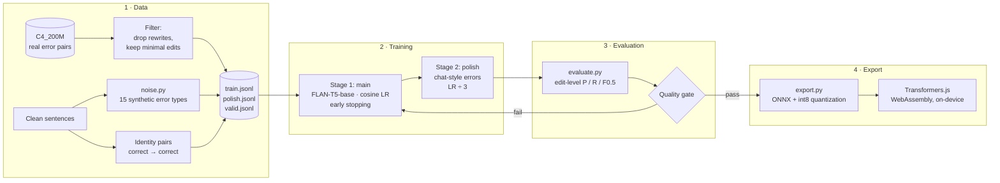
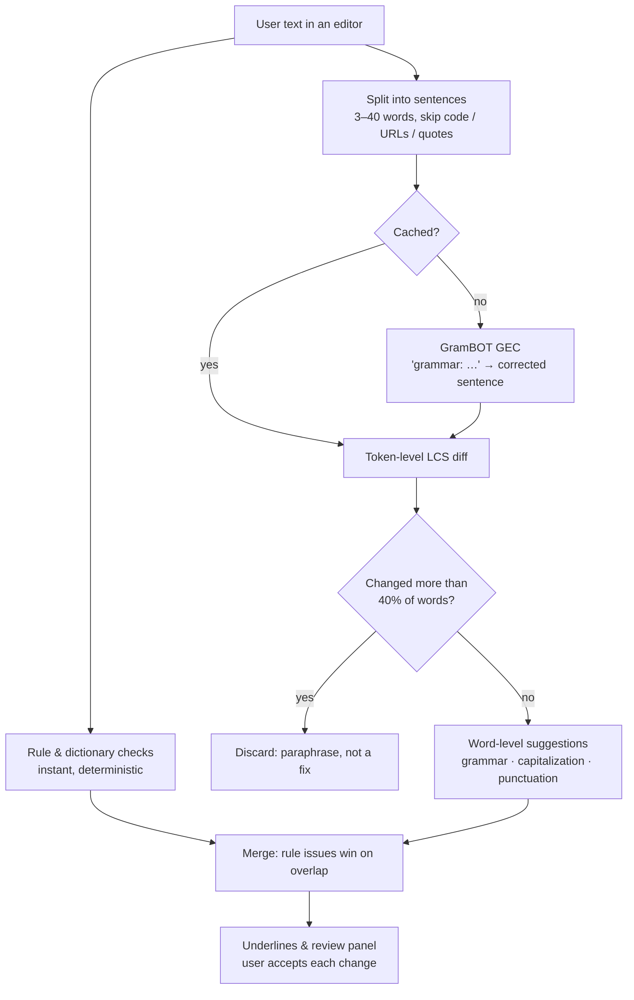
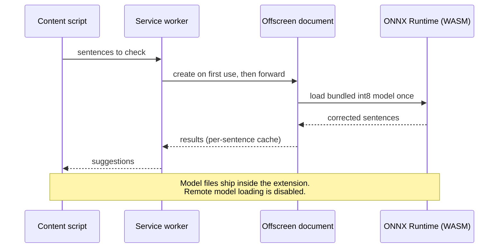

<div align="center">

# GramBOT GEC

**An on-device English grammar correction model. It is small enough to run inside a browser extension, and no text leaves the machine.**

[](https://github.com/AaryanRaj007/GramBOT/actions/workflows/check.yml)
[](LICENSE)
[](https://huggingface.co/google/flan-t5-base)
[](#model-at-a-glance)
[](#use-it-in-the-browser-transformersjs)
[](#evaluation)

</div>

---

GramBOT GEC is a sequence-to-sequence model fine-tuned from FLAN-T5-base to fix grammar, spelling, capitalization and punctuation in single English sentences. It is the AI engine behind the **Grambot** browser extension, which isn't published yet.

It was built around three constraints:

- **Private by design.** Inference runs locally on CPU through ONNX Runtime WebAssembly. No server or API key is needed, and nothing is sent over the network.
- **Fix, don't rewrite.** The training data favours minimal edits, and a large share of correct-in, correct-out pairs teaches the model to leave good text alone. In evaluation it left **14 of 14** correct sentences unchanged.
- **Open and reproducible.** Every step is in this repo: data, training, evaluation and export. It runs on free hardware: a laptop or a free Kaggle GPU.

## Contents
- [Model at a glance](#model-at-a-glance)
- [How it works](#how-it-works)
- [Evaluation](#evaluation)
- [Download](#download)
- [Quick start](#quick-start)
- [Training pipeline](#training-pipeline)
- [Repository layout](#repository-layout)
- [Limitations](#limitations)
- [License and attribution](#license-and-attribution)

## Model at a glance

| | |
|---|---|
| Architecture | T5 encoder–decoder (`google/flan-t5-base`) |
| Parameters | 248 M |
| Task | Sentence-level grammatical error correction (GEC) |
| Input format | `grammar: <sentence>` |
| Max length | 96 tokens, about 40 words |
| Training data | about 2.2 M sentence pairs: C4_200M real pairs plus 15 synthetic error types |
| Formats | PyTorch `safetensors` (fp32, 990 MB) and ONNX int8 for Transformers.js (264 MB) |
| Browser latency | median **296 ms / sentence** on an Apple M2 (CPU, WASM); first load 3.1 s |
| Language | English (US and UK spelling) |

## How it works

### End-to-end pipeline



### From a sentence to a suggestion

The model rewrites one sentence at a time. A word-level diff then turns the rewrite into small, separate suggestions that the user accepts or ignores. Text is never changed without the user's action.



### Runtime architecture (browser extension)



## Evaluation

The model is scored on edit-level **precision**, **recall** and **F0.5**, the standard GEC metrics, which weight precision twice as much as recall. A grammar checker that makes wrong edits is worse than one that misses some. Each release must pass a fixed quality gate.

| Benchmark | Precision | Recall | F0.5 | Correct sentences kept |
|---|---:|---:|---:|---:|
| 50 hand-written cases (36 with errors, 14 correct) | **91 %** | **75 %** | **0.87** | **14 / 14** |
| Held-out validation split (never trained on) | 73 % | 54 % | 0.68 | — |

**Quality gate** (`evaluate.py`): cases F0.5 ≥ 0.60, validation F0.5 ≥ 0.45, and at least 95 % of correct sentences left unchanged. **Result: PASS.**

Compared with the previous checkpoint, this release keeps cases F0.5 at 0.87 and raises validation F0.5 from 0.66 to 0.68. It also fixes the one correct sentence the previous model wrongly changed (13 / 14 → 14 / 14).

In the browser extension's pipeline (ONNX int8, WebAssembly), the model fixed **27 of 36** error cases exactly and left all 14 correct sentences unchanged.

<details>
<summary>Sample outputs</summary>

| Input | Output |
|---|---|
| She go to school every day. | She goes to school every day. |
| I has a apple. | I have an apple. |
| The children was playing in the the garden. | The children were playing in the garden. |
| Did you finished the report? | Did you finish the report? |
| I want to loose some weight. | I want to lose some weight. |
| thanks for you help yesterday | Thanks for your help yesterday. |
| my mom asked are you coming home tonight | My mom asked, "Are you coming home tonight?" |
| The API returns a 404 when the user is not found. | *(unchanged)* |

The full per-case log is in [`training/eval.txt`](training/eval.txt).
</details>

## Download

Model weights are attached to the [GitHub Releases](../../releases) page. They are too large for a git repository.

| File | Contents | Size | Use with |
|---|---|---:|---|
| `grambot-gec-onnx-int8.zip` | ONNX encoder and merged decoder (int8), tokenizer, configs | 194 MB | Transformers.js, ONNX Runtime |
| `grambot-gec-pytorch.zip` | `model.safetensors` (fp32), tokenizer, configs | 919 MB | 🤗 Transformers, further fine-tuning |
| `SHA256SUMS.txt` | Checksums | — | `shasum -a 256 -c SHA256SUMS.txt` |

## Quick start

### Python (🤗 Transformers)

```bash
unzip grambot-gec-pytorch.zip          # -> grambot-gec/
pip install "transformers>=4.46,<5" torch sentencepiece
```

```python
from transformers import AutoTokenizer, AutoModelForSeq2SeqLM

tok = AutoTokenizer.from_pretrained("grambot-gec")
model = AutoModelForSeq2SeqLM.from_pretrained("grambot-gec")

def correct(sentence: str) -> str:
    ids = tok("grammar: " + sentence, return_tensors="pt", max_length=96, truncation=True)
    out = model.generate(**ids, max_new_tokens=96)
    return tok.decode(out[0], skip_special_tokens=True)

print(correct("He dont know the answer."))  # He doesn't know the answer.
```

### Use it in the browser (Transformers.js)

```bash
unzip grambot-gec-onnx-int8.zip -d models   # -> models/grambot-gec/onnx/*.onnx
```

```js
import { env, pipeline } from '@huggingface/transformers';

env.allowRemoteModels = false;   // never fetch from the network
env.localModelPath = '/models/';

const fix = await pipeline('text2text-generation', 'grambot-gec', { dtype: 'q8', device: 'wasm' });
const [{ generated_text }] = await fix('grammar: I has a apple.', { max_new_tokens: 96 });
console.log(generated_text); // I have an apple.
```

> **Always include the `grammar: ` prefix.** The model was trained with it and behaves unpredictably without it.

## Training pipeline

The whole pipeline runs on an 8 GB Apple Silicon laptop or on a free Kaggle T4 GPU. See [`training/README.md`](training/README.md) for the step-by-step guide.

```bash
cd training
python -m venv .venv && source .venv/bin/activate
pip install -r requirements.txt

python prepare_data.py --profile strong              # build the dataset
python train.py --profile strong                     # stage 1: main
python train.py --profile strong --stage polish      # stage 2: polish
python evaluate.py --compare out/main                # score + quality gate
python export.py                                     # ONNX int8 -> models/grambot-gec
```

| Profile | Base | Training pairs | Notes |
|---|---|---|---|
| `fast` | FLAN-T5-small | ~124 k | Smoke tests and quick iteration |
| `strong` | FLAN-T5-base | ~220 k | Overnight on a laptop |
| `max` | FLAN-T5-base | ~360 k, 2 epochs | Two variants per clean sentence |
| **`mega`** *(this release)* | FLAN-T5-base | max + **1.8 M** real C4_200M pairs | Continues from a previously trained Grambot checkpoint, LR 3e-4 |

**Synthetic error types** (`noise.py`): subject–verb agreement, tense, articles, homophones, apostrophes, plurals, missing and doubled words, word order, typos, capitalization, punctuation, run-on sentences, "could of", double comparatives ("more taller") and reported speech that needs quotation marks.

**Training setup:** effective batch 32, cosine learning-rate schedule, early stopping on validation loss, and a best-checkpoint restore. The polish stage uses one third of the main learning rate.

## Repository layout

```
.
├── README.md
├── LICENSE
└── training/
    ├── README.md               step-by-step training guide
    ├── requirements.txt
    ├── noise.py                synthetic error generator (15 types)
    ├── prepare_data.py         dataset builder (profiles: fast / strong / max / mega)
    ├── train.py                two-stage fine-tuning with early stopping and resume
    ├── evaluate.py             edit-level P / R / F0.5 + quality gate
    ├── export.py               ONNX export + int8 dynamic quantization
    ├── eval_cases.json         50 hand-written evaluation cases
    ├── eval.txt                evaluation log of this release
    ├── make_kaggle_notebook.py regenerates the Kaggle notebook from the scripts
    ├── tests/                  unit tests for scoring, error generators and data filters
    └── kaggle/grambot_train.ipynb
```

## Limitations

- **Sentence-level only.** The model sees one sentence at a time, so it can't use context from surrounding sentences.
- **It can't know what you meant.** A word that is correctly spelled but wrong for the intended meaning ("I wanted there" for "I wasn't there") is often missed.
- **Some known misses** in the hand cases: "could of" → "could have", "more taller" → "taller", and splitting some run-on sentences.
- **English only**, with inputs up to about 40 words. Longer text is truncated.
- Every suggestion should be reviewed by a person. The model can occasionally change meaning, so the Grambot extension never applies AI suggestions automatically.

## License and attribution

- **Code and model weights:** [Apache License 2.0](LICENSE).
- **Base model:** [`google/flan-t5-base`](https://huggingface.co/google/flan-t5-base), Apache-2.0.
- **Training data:** [C4_200M](https://github.com/google-research-datasets/C4_200M-synthetic-dataset-for-grammatical-error-correction) synthetic GEC corpus by Google Research (CC BY 4.0). It was used through [`agentlans/grammar-correction`](https://huggingface.co/datasets/agentlans/grammar-correction) and [`liweili/c4_200m`](https://huggingface.co/datasets/liweili/c4_200m). The source text comes from C4 (ODC-BY).
- **Synthetic examples:** generated by `noise.py` in this repo.
- Datasets and models under non-commercial licences (JFLEG-trained models, CoEdIT) were deliberately excluded.

<div align="center">
<sub>Built for Grambot: free, private grammar help that runs on your device.</sub>
</div>
